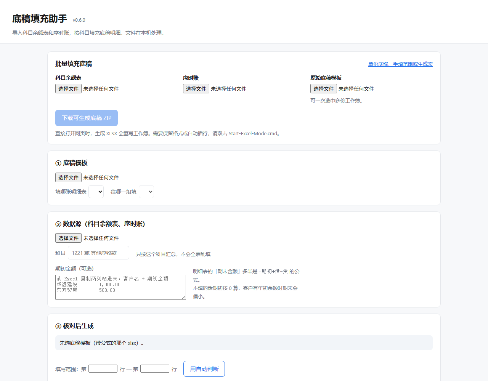
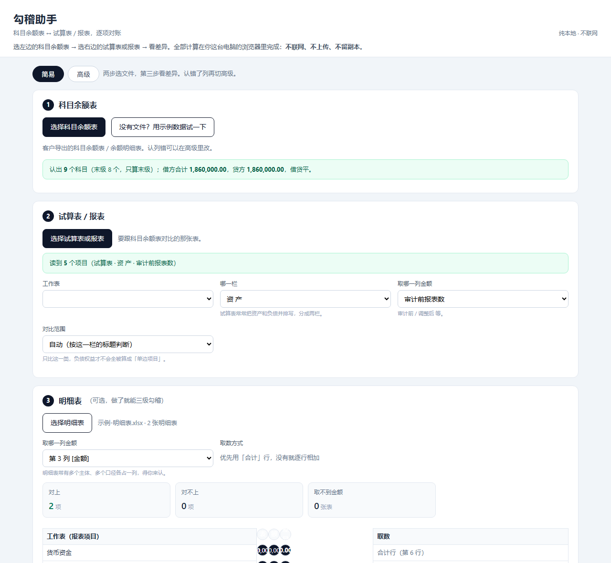
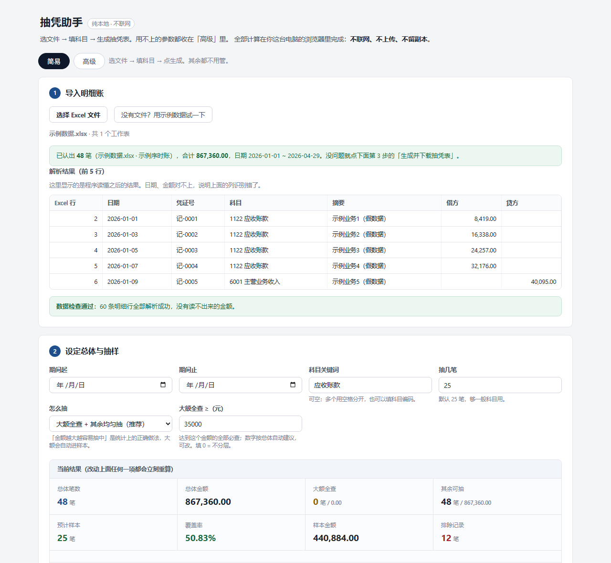
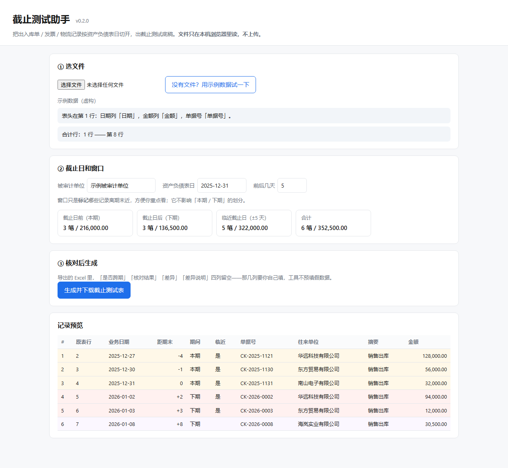
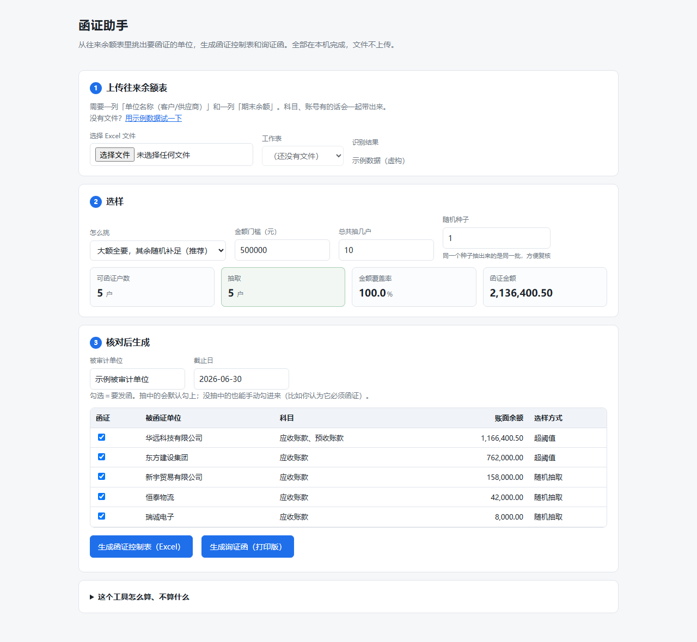

# awesome-lee2277

一个人做的一堆工具。大致分两类：**给 AI agent 用的插件**，和**给会计/审计日常用的离线小工具**。

全部本地运行，绝大多数不联网、不上传数据。许可证统一 AGPL-3.0。

> Tools I actually use. Mostly two kinds: plugins that give an AI agent new abilities, and offline single-file utilities for accounting/audit work. Everything runs locally; most never touch the network.

---

> **会计/审计专业的同学**：看下面「审计与财务工具」那一节。五个工具都是双击运行，
> 不用装 Python、不用登录、不会把客户数据传到任何地方。实习前一天装上就够用。
>
> **不想下载？** 直接在这儿试：**<https://lee2277-t.github.io/awesome-lee2277/>**
> （同一份代码，纯前端，表格只在浏览器里读）

## DeepSeek Harness 插件

装上就能在 Harness 里直接调用，无需另开窗口。

| 仓库 | 解决什么问题 |
|---|---|
| [dsh-skill-index](https://github.com/Lee2277-t/dsh-skill-index) | 技能多到塞不进系统提示时，用关键词检索本机技能库。先给约 300 token 的摘要，确定要用才读全文 |
| [dsh-repo-audit](https://github.com/Lee2277-t/dsh-repo-audit) | 项目公开前体检：凭据特征、泄漏的本机路径、缺 README/LICENSE、过大文件，逐条给行号 |
| [dsh-miniapp-audit](https://github.com/Lee2277-t/dsh-miniapp-audit) | 微信小程序提审前自查：隐私接口、`requiredPrivateInfos` 缺项、静默失败点、包体积 |
| [dsh-zip-verify](https://github.com/Lee2277-t/dsh-zip-verify) | 交付包真能原样还原吗：逐条目 CRC 校验、与源目录逐文件对账、中文名编码风险 |
| [dsh-aigc-label](https://github.com/Lee2277-t/dsh-aigc-label) | 给 docx/xlsx/pptx 写入与查验 AIGC 隐式标识（`docProps/custom.xml`） |
| [dsh-font-subset](https://github.com/Lee2277-t/dsh-font-subset) | 按页面实际用到的字裁剪字体；缺字在变成豆腐块之前就报出来 |
| [dsh-resolve](https://github.com/Lee2277-t/dsh-resolve) | 用一份声明式的剪辑清单生成可导入 DaVinci Resolve 的 `.fcpxml` |
| [pbip-forge](https://github.com/Lee2277-t/pbip-forge) | 直接生成完整的 Power BI 工程（`.pbip`）：TMDL 模型、DAX 度量、PBIR 页面 |

前六个已提交到 [awesome-dsh-plugin](https://github.com/awesome-dsh-plugin/awesome-dsh-plugin) 目录，通过审核即可在目录里搜到。

## 审计与财务工具

**审计实习最费时间的五件事，各有一个工具。下载即用，不装软件、不联网、客户数据不出本机。**

| 工具 | 解决什么问题 | 下载 |
|---|---|---|
| [底稿填充助手](https://github.com/Lee2277-t/workpaper-filler) | 序时账按客户汇总，填进底稿明细表，**公式一行不动**；填之前先告诉你填第几行到第几行 | [ZIP](https://github.com/Lee2277-t/workpaper-filler/releases/latest) |
| [勾稽助手](https://github.com/Lee2277-t/gouji-reconciler) | 明细表 → 科目余额表 → 试算表三级勾稽，差异、未映射科目、单边项目逐项列出 | [ZIP](https://github.com/Lee2277-t/gouji-reconciler/releases/latest) |
| [抽凭助手](https://github.com/Lee2277-t/vouching-sampler) | 认表、抽样、生成抽凭表、回录评估，一条流水线 | [ZIP](https://github.com/Lee2277-t/vouching-sampler/releases/latest) |
| [截止测试助手](https://github.com/Lee2277-t/cutoff-tester) | 按资产负债表日切分单据流水，生成截止测试底稿 | [ZIP](https://github.com/Lee2277-t/cutoff-tester/releases/latest) |
| [函证助手](https://github.com/Lee2277-t/confirmation-letter) | 从往来余额表生成函证控制表和询证函 | [ZIP](https://github.com/Lee2277-t/confirmation-letter/releases/latest) |



<sub>底稿填充助手：认不准版式就让你自己填行号，不会把客户写进账龄表。</sub>

| 其他审计/财务工具 | 解决什么问题 | 下载 |
|---|---|---|
| [audit-reconciliation-desk](https://github.com/Lee2277-t/audit-reconciliation-desk) | 应收应付逐家核对净额的双边对账核销，网页版双击即用，另有桌面版 | [ZIP](https://github.com/Lee2277-t/audit-reconciliation-desk/releases/latest) |
| [credit-doc-field-review](https://github.com/Lee2277-t/credit-doc-field-review) | 抽取信贷资料里的字段，点字段能定位回原文，逐项确认后导出结果表 | [ZIP](https://github.com/Lee2277-t/credit-doc-field-review/releases/latest) |

<details>
<summary><b>另外四个工具的界面（点开看）</b></summary>

**勾稽助手** — 科目余额表 → 试算表，逐项对账


**抽凭助手** — 认表 → 抽样 → 抽凭表


**截止测试助手** — 按资产负债表日切分单据


**函证助手** — 往来余额 → 函证控制表


</details>

## 文档、翻译与媒体

| 仓库 | 解决什么问题 |
|---|---|
| [pdf-page-tools](https://github.com/Lee2277-t/pdf-page-tools) | 按页、章节、页码范围或关键词拆分 PDF / Word / PPT |
| [document-translator](https://github.com/Lee2277-t/document-translator) | Windows 桌面文档翻译，支持双语输出、扫描件 OCR、本地离线翻译 |
| [jingyin-watermark-remover](https://github.com/Lee2277-t/jingyin-watermark-remover) | 本机批量去除图片与视频水印，三种修复引擎，视频逐帧修复与动态跟踪 |
| [mediakit](https://github.com/Lee2277-t/mediakit) | 给 agent 用的媒体命令行 + MCP 服务：看视频、分析音乐、字幕、配音、卡点剪辑 |

## 系统与发布

| 仓库 | 解决什么问题 |
|---|---|
| [win-cache-relocator](https://github.com/Lee2277-t/win-cache-relocator) | 把 C 盘上会一直长回来的缓存目录搬到别的盘，原路径留 Junction，复制前逐字节校验，可一键撤销 |
| [github-publish-playbook](https://github.com/Lee2277-t/github-publish-playbook) | 从本地到 GitHub Release 的完整手册：隐私清洗、命令速查、排错 |

## 技能与索引

| 仓库 | 说明 |
|---|---|
| [agent-skills](https://github.com/Lee2277-t/agent-skills) | 35 个实战迭代出来的 agent 技能，每个都写明**什么时候不该用** |
| [skill-hub](https://github.com/Lee2277-t/skill-hub) | 把散落各处的技能收拢成一份可检索索引，写进 `AGENTS.md` 让 DSH / Codex / Claude 自动看见 |

另有一个包含 173 个技能、14 个分类的私有技能库。工具已经公开（见 `dsh-skill-index`），技能内容因为是给自己的，暂不对外。

## 其他

| 仓库 | 说明 |
|---|---|
| [kurumi-ysm](https://github.com/Lee2277-t/kurumi-ysm) | 福贺久留美的 Minecraft YSM 自定义模型，10 表情 / 10 动作 / 26 动画 |
| [zjgsu-campus](https://github.com/Lee2277-t/zjgsu-campus) | 浙江工商大学校园服务小程序（纪念归档，云环境已停用） |

---

## 怎么用

**DSH 插件**：在 Harness 里执行

```bash
dsh plugin add <仓库地址>
```

或用内置的插件面板安装。装完工具会出现在工具列表里。

**离线工具**：进仓库，`README` 第一段就写了怎么打开——多数是双击一个 HTML 文件。

## 关于

这些工具都是先有具体问题、再有代码的：对账对到半夜、交付包解压出来是乱码、中文字体 9 MB 拖垮首屏、小程序因为隐私声明被驳回。写下来是为了下次不用重来一遍。

License: [AGPL-3.0](LICENSE)
